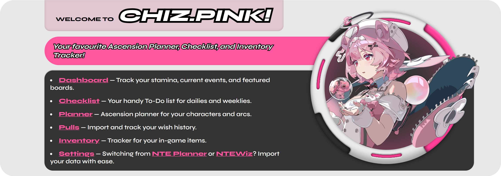
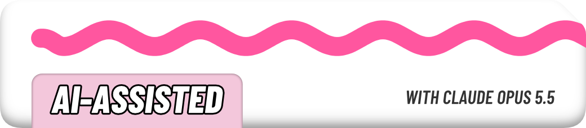

**Chiz.Pink** is your pinkest campanion and favourite planner and inventory tracker for Neverness To Everness :3

I made this because I wanted a nice looking and easier to use
companion tool than what already exists. Inspired by a combination
of [Paimon.moe](https://paimon.moe), [Genshin Center](https://genshin-center.com), and [Star Rail Station](https://starrailstation.com).
These are tools that I've used for a very long time and I wanted a similar experience for NTE.

The inventories on Genshin Center and Star Rail Station were
sorted in the same order as the items were in-game. But almost all
NTE tools I've seen, sorts alphabetically or by the item type. It
was frustrating to scroll up and down and find the right item.
That frustration is what made **Chiz.Pink**.

> I'm not affiliated with or endorsed by the Hotta Studio, it's just a fan project.

## What it does

- :calendar: **Character & Arc Planners** - Plan and track levelling and ascension progress.
- :books: **Character & Arc Catalog** - Browse every Character and Arc for a basic overview.
- :school_satchel: **Inventory Tracker** - Keep account of every usable item - owned/required/acquired.
  Comes with a variety of ways to Filter, Group and Sort items just the way you need it.
- :game_die: **Pull Tracker** - Keep a record of all your pulls across both the limited banners and the permanent banner, with a handy pity counter and stats for those nerds.
- :bookmark_tabs: **Daily/Weekly/Bi-Weekly Checklist** - You will never miss earning even a single fon.
  Ever. Trust. :heart:
- :computer: **Offline-First** - Works fully offline out of the box, no account needed. Everything
  lives in your browser's IndexedDB.
- :cloud: **Cloud Sync** (Optional) - Sign-in with Google if you want to sync across devices - your data
  gets encrypted on your own device before it ever touches the database, so
   I couldn't read it even if I wanted to. Full breakdown here: [`Privacy Policy`](https://chiz.pink/privacy)
  if you're curious how that works.
- :iphone: **Native App** - Install Chiz.Pink as a PWA. If you don't know what that is, it installs the webapp on
  your device like any other app you find on the Play Store, App Store or Microsoft Store.

## What it doesn't

- Chiz.Pink is not a database or a wiki for NTE. It does provide information on all Characters and Arcs.
  But beyond that please don't expect any builds or guides.

## Tech Stack

Built with [Next.js 16](https://nextjs.org) (App Router) + React 19.

Sign-in runs on [next-auth](https://next-auth.js.org) v4 (Google OAuth).

Cloud sync runs on [Convex](https://www.convex.dev). Poke around `convex/` and
`src/helpers/CloudSyncProvider.tsx` if you want to see how it all fits
together. **Full transparency:** I built this part with Claude, the
syncing/encryption and Convex backend were vibe-coded. I am not a back-end dev,
so apologies to all the purists out there, just believe me when I say that I
would've done it myself if I could. Some things were just too complicated
for my skillset :shrug:

Styling's just plain CSS Modules, nothing fancy.

## Contribution

I'm not looking for any contributors at the moment. The code was not written with
contributors in mind. I'm just a guy :standing_person: I just do what works.
